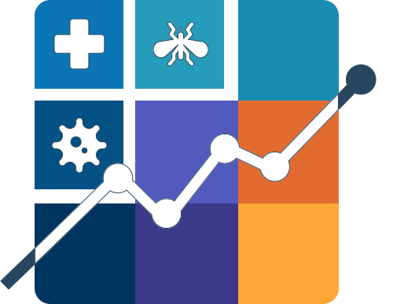

# ICV

<div align="center">



# ICV — Interactive Context-rich Views for Public Health Data

Open-source, composable web framework for creating release-ready public health emergency interfaces with context-rich, explainable views.

</div>

<table style="width:100%;">
    <tr>
        <td align="center">React</td>
        <td align="center">Node 25.8</td>
        <td align="center">Next.js</td>
        <td align="center">TypeScript</td>
        <td align="center">Tailwind CSS</td>
        <td align="center">Python 3.12</td>
        <td align="center">Flask API</td>
        <td align="center">Docker 29.3</td>
        <td align="center">PostgreSQL</td>
        <td align="center">D3</td>
        <td align="center">Leaflet</td>
        <td align="center">Recharts</td>
    </tr>
     <tr>
        <td align="center"></td>
        <td align="center"></td>
        <td align="center"></td>
        <td align="center"></td>
        <td align="center"></td>
        <td align="center"></td>
        <td align="center"></td>
        <td align="center"></td>
        <td align="center"></td>
        <td align="center"></td>
        <td align="center"></td>
        <td align="center"></td>
    </tr>
</table>

## Run the tool
To run the tool execute the following command: 
```bash
docker compose up
```

## Build Dependencies

>
> [!NOTE]
> If you want to further develop and/or build the tool yourself, the following dependencies are prerequisites:
> Node, Docker, and Python have to be installed -> see versions above.

```bash
#install packages
npm install

```

## Local Development
> [!WARNING]
> Ensure that the docker service is running!

```bash
# run database & build + watch changes + run website 
npm run dev
```

## Documentation

The documentation portal is available at `/en/docs` and `/de/docs` and is separated by audience:

- **User Guide:** task-oriented product guidance in English and German.
- **Developer Guide:** architecture, engineering practices, REST reference, and generated TypeScript API in English.

```bash
# regenerate the public TypeScript API reference
npm run docs:api

# regenerate the API reference and start the documentation locally
npm run docs:dev

# regenerate documentation and run the TypeScript check
npm run docs:check
```

Do not edit files under `content/docs/developer-guide/api/typescript` manually. Update TSDoc or `src/framework/index.ts` and regenerate them instead.

page available at: [http://localhost:3000](http://localhost:3000) (see terminal log)

> [!NOTE]
>or DB access and building the docker container there is an *.env* file at the root level of the repository where you can adjust the following content:
>* DATABASE_URL="postgresql://icv_user:<DB_PASSWORD>@icv-database:5333/icv-database?schema=public"
>* DATABASE_URL_SECRET="postgresql://icv_user:<DB_PASSWORD>@icv-database:5333/icv-database?schema=public"
>* DB_PASSWORD_SECRET="<DB_PASSWORD>"

To run the frontend and backend in separate terminals while debugging:
```bash
# 1. terminal:
npm run flask-dev

# 2. terminal
npm run next-dev
```

## Local Start from a Production Build

Build the Next.js frontend, then start it together with the local Flask backend. The backend startup also starts the database container, as in `npm run dev`:

```bash
npm run build
npm run start
```

# Docker

* ## Dockerize the Application

    ```bash
    # build & run the application
    npm run docker
    ```
  * ### (optional) dev commands
    * #### start containers
        ```bash
        # only start the already build containers: 
        npm run docker-run
        ```
    * #### force a clean rebuild of the images and run containers
        ```bash
        # build & run
        npm run docker-noCache
        ```

    * #### individually build & run Docker containers

        ```bash
        #Build your containers: 
        docker compose build icv-database
        docker compose build icv-backend
        docker compose build icv-frontend

        #Run your containers (each in an individual terminal): 
        docker compose up icv-database
        docker compose up icv-backend
        docker compose up icv-frontend
        ```

## Inspect the Database

```bash
# starts the database and the read-only pgweb browser
npm run db-view
```

The database browser opens at [http://127.0.0.1:8081](http://127.0.0.1:8081). It is bound to the local machine and is not started by the regular `docker compose up` command.

## General Info

see also [next.js_docu_deployment](https://nextjs.org/docs/app/building-your-application/deploying)

## License

This project is licensed under the **GNU GPL-3.0 License** - see the [LICENSE](LICENSE) file for details.

Copyright (c) 2026 ICV Contributors

## Funding

This project is funded by the Federal Ministry of Health (BMG) under grant No. 2523DAT400 (project: AI-DAVis PANDEMICS)


For more information about the project and funding, see: [AI-DAVis PANDEMICS](https://www.bundesgesundheitsministerium.de/ministerium/ressortforschung/handlungsfelder/digitalisierung/ai-davis-pandemics.html)

### Third-Party Licenses

This project uses many open-source libraries and components. For a comprehensive list of all dependencies and their licenses, see [DEPENDENCIES.md](DEPENDENCIES.md).

**Key Dependencies Highlights:**
- **Frontend:** React, Next.js, Tailwind CSS (MIT/Apache-2.0)
- **Backend:** Flask, NumPy, PostgreSQL drivers (BSD-3-Clause)
- **UI Components:** Radix UI, Recharts, D3, Leaflet
- **Icons:** Font Awesome (CC BY 4.0), Game Icons (CC BY 3.0)
- **Utilities:** Swapy (GPL-3.0), pgweb (MIT, development only)

